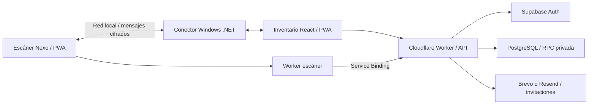

# Nexo Inventario

Inventario para pequeños negocios, con empresas independientes, compras, ventas y un celular Android que funciona como lector del PC.

**[Abrir Nexo](https://nexo-inventario.loby207.workers.dev)** · **[Escáner Nexo](https://nexo-escaner.loby207.workers.dev)** · **[Instalación paso a paso](docs/INSTALACION.md)** · **[Uso del escáner](docs/ESCANER.md)**

La aplicación publicada requiere una cuenta autorizada. Clonar este repositorio no concede acceso a su inventario: usa la demo local o configura tus propios servicios.

## Qué incluye

- Acceso con Supabase Auth: contraseña, verificación y recuperación por correo; invitaciones a empresas y roles de administrador/empleado.
- Catálogo con SKU, códigos comerciales, proveedores, precios y existencias; compras y ventas transaccionales, reportes e importación Excel/CSV.
- PWA instalable e IndexedDB: productos y operaciones offline durante 24 horas tras validar el equipo, sincronización con identificadores estables y revisión de conflictos.
- Escáner PWA independiente: cámara, códigos manuales y lector USB/Bluetooth; conexión cifrada con Windows mediante un conector .NET autónomo en la misma red.
- Etiquetas Code 128 del SKU, descarga PNG/SVG e impresión de 50 × 30 mm en A4.
- Interfaz en español, COP, diseño adaptable y navegación con rutas recuperables.

## Demo local rápida

Requisitos: Git y Node.js **22.13 o superior** (se recomienda Node 24). No requiere cuenta de Supabase, Cloudflare ni .NET para explorar el inventario.

```powershell
git clone https://github.com/loby0000/nexo-inventario.git
cd nexo-inventario
npm ci
npm run standalone:build
node standalone/tests/preview-server.mjs
```

Abre **http://127.0.0.1:5191**. Usuario ficticio: `admin@nexo.test`; contraseña ficticia: `Prueba-nexo-2026`.

Esta demo usa PostgreSQL embebido y acceso simulado: no envía correos, no utiliza datos reales y reinicia la base al detener el proceso. Nunca publiques ese servidor de pruebas. Para uso real y persistente, sigue la [guía completa](docs/INSTALACION.md).

## Arquitectura



El navegador recibe solo la clave publicable de Auth. El Worker valida usuario y membresía; las tablas del esquema `nexo` no se consultan directamente desde el navegador. El teléfono añade unidades al borrador; **solo confirmar en el PC modifica las existencias**.

## Tecnologías y carpetas

| Carpeta | Contenido |
| --- | --- |
| `standalone/client`, `standalone/ui` | React, TypeScript, Vite, React Router, PWA e interfaz |
| `standalone/server` | Workers, API, correo y autorizaciones firmadas |
| `standalone/connector` | Conector Windows x64, .NET 10 |
| `standalone/shared` | Protocolo versionado y cifrado del enlace |
| `supabase/migrations` | Esquema, empresas, permisos y transacciones PostgreSQL |
| `standalone/tests` | Pruebas unitarias, base de datos y arneses de integración |
| `specs`, `.specify` | Especificaciones y contratos de GitHub Spec Kit |
| `app`, `worker`, `drizzle` | Implementación anterior del alojamiento privado; referencia histórica |

**La versión actual se ejecuta con los comandos `standalone:*`**. Los comandos raíz `dev/build` corresponden a la versión anterior y no son el punto de inicio de esta entrega.

## Comprobar el proyecto

```powershell
npm run standalone:check
npm run standalone:test
npm run standalone:build
npm run scanner:build
```

Los arneses de navegador y de conector tienen requisitos adicionales descritos en la guía. Las simulaciones no sustituyen pruebas físicas de cámara, red o impresora. El propietario comprobó cámara y enlace Android/Windows en una red compartida; no se garantiza cualquier aparato o configuración de red.

## Límites de esta versión

El enlace celular/PC requiere el mismo Wi‑Fi o hotspot; no conecta redes remotas. La preparación offline requiere internet y acceso válido inicialmente. Conflictos de existencias se revisan sin crear stock artificial. La demo pública mantiene cerrado el registro libre: habilitarlo en una instalación propia exige configurar y probar correo y Turnstile.

No se incluyen contraseñas reales, claves privadas, sesiones, bases de datos, copias de seguridad ni ejecutables generados. Consulta [seguridad](SECURITY.md) y la [guía de despliegue](docs/INSTALACION.md) antes de publicar tu propia copia.
